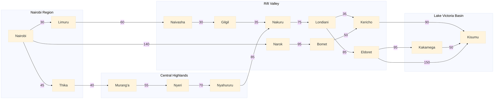
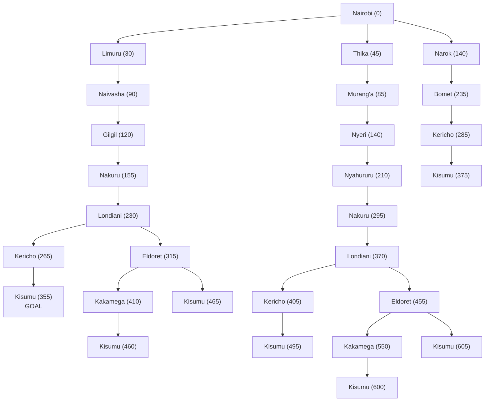

# PS-Agents: Self-Driving Trailer Agent Design
## Group photo

## 1. Agent design using PEAS

| PEAS element | Description |
|---|---|
| **Performance measure** | Safe arrival with no accidents or cargo damage, shortest total distance and travel time, low fuel use, on-time delivery, obeying traffic laws and axle-load limits, minimal tolls and detours. |
| **Environment** | Kenyan highways and town roads other vehicles, matatus, motorbikes, pedestrians and livestock, weather road works, traffic jams, police checks, road signs and signals, steep escarpments and sharp bends. |
| **Actuators** | Steering, accelerator, brakes, gear selection, indicators, headlights, horn, wipers, route display and alerts to the dispatcher. |
| **Sensors** | GPS, camera, speedometer, odometer, fuel gauge, tyre-pressure and load sensors. |

### Environment properties

| Property | Classification | Reason |
|---|---|---|
| Observability | **Partially observable** | Sensors have limited range and cannot see round bends, behind trucks or the intentions of other drivers, road conditions ahead are not fully known. |
| Number of agents | **Multi-agent**  | Other drivers, pedestrians and trucks act independently, drivers cooperate by following traffic rules and compete for road space. |
| Determinism | **Stochastic** | The result of an action is uncertain, traffic, weather, breakdowns and other drivers' behaviour change the outcome. |
| Episodic vs sequential | **Sequential** | Each decision (route choice, overtaking, braking) affects later states and the rest of the trip. |
| Static vs dynamic | **Dynamic** | The environment keeps changing while the agent decides (moving traffic, weather, road closures). |

## 2. Directed graph and search tree

### 2.1 Problem formulation

- **States:** the town where the trailer currently is.
- **Initial state:** Nairobi.
- **Goal state:** Kisumu.
- **Actions:** drive along a highway to the next town on the way to Kisumu.
- **Transition model:** driving from town A to B along road A–B puts the trailer in B.
- **Path cost:** road distance in kilometres (sum of the edge distances).

### 2.2 Abstraction

**Level 1: regions (abstract graph).** Details such as individual towns and roads are removed so the agent can first decide which regions to pass through.

Within Level 2, the chain Limuru → Naivasha → Gilgil → Nakuru is a single highway corridor (A104), so the agent treats it as one action Nairobi to Nakuru, 155 km" when planning at the abstract level and only expands it into towns when driving it. In the same way, "Nakuru to Kisumu" is one abstract action with three possible refinements (see the tree below).

### 2.3 Search tree

Each node shows the town and the path cost g(n) from Nairobi in km. Every branch ends at Kisumu, so the tree contains only routes from Nairobi to Kisumu. Nakuru appears twice because it can be reached by two different routes (via Limuru, 155 km, and via Thika and Nyahururu, 295 km).

## 3. Optimal path from Nairobi to Kisumu

### 3.1 All routes from Nairobi to Kisumu

| No. | Route | Distance (km) |
|---|---|---|
| 1 | Nairobi → Limuru → Naivasha → Gilgil → Nakuru → Londiani → Kericho → Kisumu | 355 |
| 2 | Nairobi → Narok → Bomet → Kericho → Kisumu | 375 |
| 3 | Nairobi → Limuru → Naivasha → Gilgil → Nakuru → Londiani → Eldoret → Kakamega → Kisumu | 460 |
| 4 | Nairobi → Limuru → Naivasha → Gilgil → Nakuru → Londiani → Eldoret → Kisumu | 465 |
| 5 | Nairobi → Thika → Murang'a → Nyeri → Nyahururu → Nakuru → Londiani → Kericho → Kisumu | 495 |
| 6 | Nairobi → Thika → Murang'a → Nyeri → Nyahururu → Nakuru → Londiani → Eldoret → Kakamega → Kisumu | 600 |
| 7 | Nairobi → Thika → Murang'a → Nyeri → Nyahururu → Nakuru → Londiani → Eldoret → Kisumu | 605 |

### 3.2 Uniform-cost search (Dijkstra) using distance as path cost

The node with the lowest g(n) is expanded first.

| Step | Node expanded | g(n) | Frontier updates |
|---|---|---|---|
| 1 | Nairobi | 0 | Limuru 30, Thika 45, Narok 140 |
| 2 | Limuru | 30 | Naivasha 90 |
| 3 | Thika | 45 | Murang'a 85 |
| 4 | Murang'a | 85 | Nyeri 140 |
| 5 | Naivasha | 90 | Gilgil 120 |
| 6 | Gilgil | 120 | Nakuru 155 |
| 7 | Narok | 140 | Bomet 235 |
| 8 | Nyeri | 140 | Nyahururu 210 |
| 9 | Nakuru | 155 | Londiani 230 |
| 10 | Nyahururu | 210 | Nakuru 295 (worse than 155, ignored) |
| 11 | Londiani | 230 | Kericho 265, Eldoret 315 |
| 12 | Bomet | 235 | Kericho 285 (worse than 265, ignored) |
| 13 | Kericho | 265 | Kisumu 355 |
| 14 | Kisumu | 355 | goal reached |

**Optimal path:** Nairobi → Limuru → Naivasha → Gilgil → Nakuru → Londiani → Kericho → Kisumu

**Total cost:** 30 + 60 + 30 + 35 + 75 + 35 + 90 = **355 km**

Uniform-cost search is optimal here because all step costs are positive, so the first time Kisumu is selected for expansion its cost is the lowest possible.

